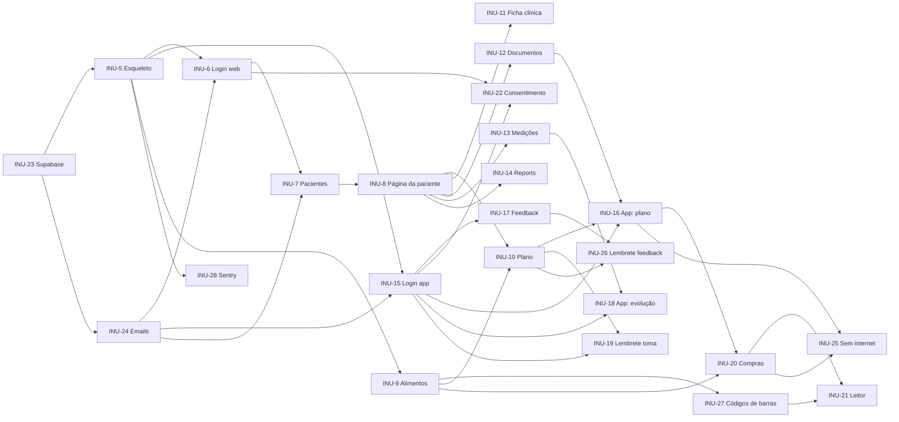

# inutri — plano de implementação (primeira versão)

A ordem em que as tarefas se constroem, que **não é a ordem dos números**. Cada tarefa só começa quando as tarefas de que depende estão integradas em `develop`. As dependências vêm do campo **Depende de** de cada tarefa no Jira; se mudarem lá, atualiza-se aqui.

Feito a 24/11/2026. Base: [modelo-de-dados.md](modelo-de-dados.md), [decisoes.md](decisoes.md).

## Antes de tudo (fora do código, pelos donos)

Nada disto bloqueia a fase 1, mas cada item bloqueia uma tarefa mais à frente.

| O quê | Quem | Bloqueia |
|---|---|---|
| Guardar o mockup no repositório (`docs/mockup/`) ou partilhá-lo com o Olegário | Inês | Todos os ecrãs (fase 3 em diante) nas sessões do Olegário |
| Confirmar se a Supabase Auth suporta passkeys e código por email como segundo passo | qualquer dono (ou a sessão da INU-6) | INU-6 |
| Confirmar a licença da tabela do INSA | qualquer dono | Importação na INU-9 (o resto da INU-9 avança) |
| Confirmar a licença da Open Food Facts (ODbL) | qualquer dono | INU-21 |
| Contas: Supabase, Brevo, Sentry, Cloudflare (planos gratuitos) | Olegário | INU-23, INU-24, INU-28, INU-5 |
| Textos legais, prazo de conservação, avaliação de impacto (jurista) | donos | Dados reais (fase final) |
| Acordos de tratamento de dados (DPA) da Supabase e da Brevo | donos | Dados reais (fase final) |

## Fases

Dentro de cada fase, as tarefas podem correr **ao mesmo tempo**, cada uma no seu branch e no seu pull request.

| Fase | Tarefas | O que fica a funcionar |
|---|---|---|
| **1. Base de dados** | [INU-23](https://olegarioncnascimento.atlassian.net/browse/INU-23) Supabase, modelo de dados e regras de acesso | Projetos de teste e produção na UE, todas as tabelas e regras, com testes |
| **2. Esqueleto** | [INU-5](https://olegarioncnascimento.atlassian.net/browse/INU-5) website e app a arrancar · [INU-24](https://olegarioncnascimento.atlassian.net/browse/INU-24) emails e página da palavra-passe | Website no Cloudflare e app em Android/iOS ligados à Supabase; checks a testar app, website e base de dados |
| **3. Entrar** | [INU-6](https://olegarioncnascimento.atlassian.net/browse/INU-6) login da nutricionista · [INU-15](https://olegarioncnascimento.atlassian.net/browse/INU-15) login da paciente · [INU-9](https://olegarioncnascimento.atlassian.net/browse/INU-9) base de alimentos · [INU-28](https://olegarioncnascimento.atlassian.net/browse/INU-28) Sentry | As duas pessoas entram; a base de alimentos existe |
| **4. Pacientes** | [INU-7](https://olegarioncnascimento.atlassian.net/browse/INU-7) lista e convite · [INU-17](https://olegarioncnascimento.atlassian.net/browse/INU-17) feedback semanal na app · [INU-22](https://olegarioncnascimento.atlassian.net/browse/INU-22) consentimento · [INU-27](https://olegarioncnascimento.atlassian.net/browse/INU-27) ligar códigos de barras | A nutricionista convida pacientes; a paciente dá consentimento e envia feedback |
| **5. Página da paciente** | [INU-8](https://olegarioncnascimento.atlassian.net/browse/INU-8) página com separadores | A nutricionista abre cada paciente |
| **6. Trabalho da nutricionista** | [INU-10](https://olegarioncnascimento.atlassian.net/browse/INU-10) folha do plano · [INU-11](https://olegarioncnascimento.atlassian.net/browse/INU-11) ficha clínica · [INU-12](https://olegarioncnascimento.atlassian.net/browse/INU-12) documentos · [INU-13](https://olegarioncnascimento.atlassian.net/browse/INU-13) medições e doses · [INU-14](https://olegarioncnascimento.atlassian.net/browse/INU-14) reports | O website está completo |
| **7. App da paciente** | [INU-16](https://olegarioncnascimento.atlassian.net/browse/INU-16) início, plano e documentos · [INU-18](https://olegarioncnascimento.atlassian.net/browse/INU-18) evolução e medições · [INU-19](https://olegarioncnascimento.atlassian.net/browse/INU-19) lembrete da toma · [INU-26](https://olegarioncnascimento.atlassian.net/browse/INU-26) lembrete do feedback | A paciente vê o plano, a evolução e recebe lembretes |
| **8. Compras** | [INU-20](https://olegarioncnascimento.atlassian.net/browse/INU-20) guia de compras | Guia por supermercado |
| **9. Fecho** | [INU-21](https://olegarioncnascimento.atlassian.net/browse/INU-21) código de barras · [INU-25](https://olegarioncnascimento.atlassian.net/browse/INU-25) leitura sem internet | A app completa da primeira versão |

**Caminho crítico** (a sequência mais longa, que define o tempo total): INU-23 → INU-5 → INU-6 → INU-7 → INU-8 → INU-10 → INU-16 → INU-20 → INU-25. Atrasar uma destas atrasa tudo; as outras têm folga.

## Dependências

## Duas pessoas, duas linhas

Sugestão para trabalharem em paralelo sem se bloquearem (cada um escolhe a sua):

- **Linha website:** INU-6 → INU-9 → INU-7 → INU-27 → INU-8 → INU-10 → INU-13 → INU-12 → INU-11 → INU-14.
- **Linha app e servidor:** INU-23 → INU-5 → INU-24 → INU-28 → INU-15 → INU-17 → INU-22 → (espera pela INU-10) INU-19 → INU-26 → INU-16 → INU-18 → INU-20 → INU-21 → INU-25.

A linha app espera pela linha website na fase 6 (INU-10, INU-12, INU-13). Enquanto espera, adianta INU-17, INU-22 e INU-28.

## Antes de entrarem dados reais

A primeira versão só recebe pacientes reais quando:
- INU-22 (consentimento) está feita, com os textos do jurista;
- os acordos de tratamento de dados da Supabase e da Brevo estão assinados;
- o projeto Supabase de produção tem cópias de segurança testadas (INU-23);
- o Sentry está ligado e filtra dados pessoais (INU-28).

## Ainda sem tarefa

Trabalho que vai ser preciso e ainda não tem tarefa no Jira:
- **Publicar a app para teste** (TestFlight e teste interno do Google Play), com as contas Apple Developer (99 USD/ano) e Google Play (25 USD, uma vez), pagas pelos donos.
- **Passar para produção:** website no domínio final, app a apontar para o projeto Supabase de produção.
- **Nome da app**, ainda por decidir.
